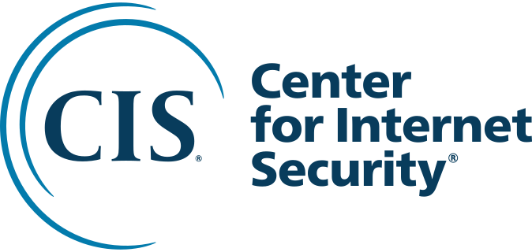
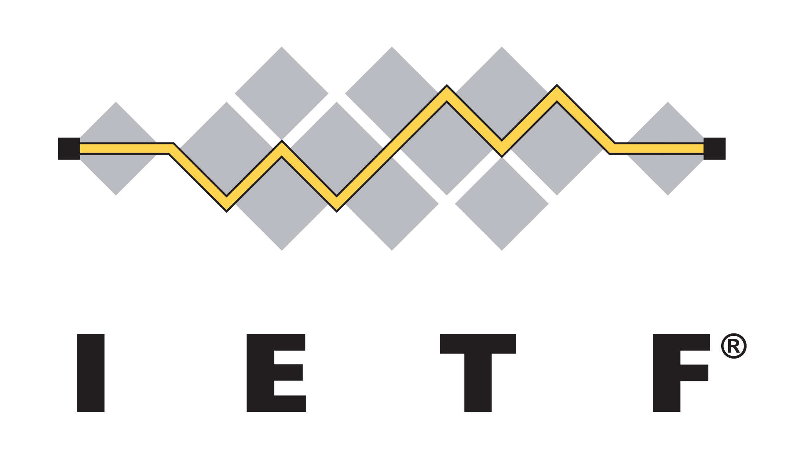

# Aircrack Wi-Fi

**Un guide pratique pour tester la sécurité de son point d’accès Wi-Fi dans un environnement isolé et contrôlé.**

Par **Kanjak** · [Site web](https://kanjakitude.com) · [Contact](mailto:kanjak.breniacs@gmail.com)

---

## Présentation

Ce dépôt présente une démarche en **sept étapes** pour prendre en main Aircrack-ng sous Ubuntu et évaluer la résistance du mot de passe WPA2 de son propre point d’accès (AP).

Le parcours couvre la vérification du matériel, le mode moniteur, la capture d’un échange d’authentification (*handshake*) et le test hors ligne de mots de passe à l’aide d’un dictionnaire.

**[Consulter le guide complet →](HOW.md)**

## Cadre du laboratoire

Les manipulations sont destinées à ton propre matériel ou à un réseau pour lequel tu disposes d’une autorisation explicite. Utilise un environnement de test isolé et contrôlé, avec un point d’accès et un appareil client dédiés.

## Prérequis

- Un ordinateur sous **Ubuntu**, avec un accès administrateur (`sudo`).
- Une carte ou un adaptateur Wi-Fi prenant en charge le **mode moniteur**.
- Un point d’accès **WPA2-Personal (PSK)** que tu contrôles.
- Un appareil client que tu peux connecter et reconnecter à ce point d’accès.
- Une connexion Internet pour télécharger les outils et le dictionnaire.
- De l’espace disque pour le dictionnaire et les fichiers de capture.

Le guide détaille l’installation d’**Aircrack-ng**, d’**iw** et du dictionnaire **RockYou** via **SecLists**.

### Vérifier et installer les prérequis

Sur Ubuntu, utilise le script [prerequis.sh](prerequis.sh) :

```bash
# Vérifier uniquement (mode par défaut)
bash prerequis.sh --check

# Installer uniquement les prérequis manquants
sudo bash prerequis.sh --install
```

Le script vérifie les paquets nécessaires, la présence de RockYou et la prise en charge du mode moniteur. Le mode installation ajoute les paquets manquants et télécharge RockYou depuis [SecLists](https://github.com/danielmiessler/SecLists/tree/master/Passwords/Leaked-Databases) dans `/usr/share/wordlists/rockyou.txt` si nécessaire. Il ne lance aucune capture et ne modifie pas le mode de l’interface Wi-Fi. Une connexion Internet est nécessaire pour l’installation ; le téléchargement de RockYou demande environ 500 Mio libres dans le dossier temporaire et dans `/usr/share`.

Le code de sortie est `0` si les vérifications passent. Un code non nul signale un prérequis manquant ou un échec (`2` pour un argument invalide). La présence du point d’accès et de l’appareil client reste à vérifier manuellement.

## Le parcours en sept étapes

| Étape | Objectif |
| --- | --- |
| **1. Vérifier la compatibilité** | Identifier la carte Wi-Fi et vérifier la prise en charge du mode moniteur avec `iw`. |
| **2. Découvrir le mode moniteur** | Activer ce mode manuellement et savoir revenir au fonctionnement normal. |
| **3. Préparer le dictionnaire** | Télécharger et extraire RockYou depuis SecLists. |
| **4. Installer Aircrack-ng** | Installer la suite et identifier l’interface Wi-Fi. |
| **5. Observer le point d’accès** | Utiliser `airmon-ng` et `airodump-ng` pour repérer le réseau du laboratoire. |
| **6. Capturer le handshake WPA2** | Cibler le point d’accès du laboratoire et enregistrer l’échange d’authentification. |
| **7. Tester le mot de passe** | Analyser la capture hors ligne avec Aircrack-ng et le dictionnaire préparé. |

Retrouve les commandes et les explications de chaque étape dans **[HOW.md](HOW.md)**. Adapte les noms d’interfaces, les adresses MAC, le canal et les chemins à ton environnement.

## Comprendre les résultats

- **`KEY FOUND!`** : un candidat du dictionnaire correspond au mot de passe du réseau testé.
- **Aucun mot de passe trouvé** : les candidats testés n’ont pas permis de retrouver la clé. Ce résultat ne suffit pas à démontrer la robustesse du mot de passe.

## Contenu du dépôt

| Fichier | Contenu |
| --- | --- |
| [README.md](README.md) | Présentation, prérequis et vue d’ensemble du parcours. |
| [HOW.md](HOW.md) | Guide détaillé avec les commandes et les explications. |
| [prerequis.sh](prerequis.sh) | Vérification et installation des prérequis sous Ubuntu. |

---

**Kanjak** · [kanjakitude.com](https://kanjakitude.com) · [kanjak.breniacs@gmail.com](mailto:kanjak.breniacs@gmail.com)

## Conseil : choisir un mot de passe robuste

Pour ton réseau Wi-Fi, choisis un mot de passe **long, aléatoire et unique**, d’au moins **16 caractères**, généré et conservé dans un gestionnaire de mots de passe. Une phrase de passe composée de plusieurs mots choisis au hasard est aussi une option. Ces principes suivent les [recommandations de la CISA](https://www.cisa.gov/sites/default/files/2024-09/Secure-Our-World-Passwords-Tip-Sheet.pdf).

**Un mot de passe absent de RockYou n’est pas forcément robuste : l’échec d’un test par dictionnaire ne garantit pas la sécurité de ton réseau.**

---

## L’écosystème cybersécurité

| [Kali Linux](https://www.kali.org/) | [Wireshark](https://www.wireshark.org/) | [OWASP](https://owasp.org/) | [Hack The Box](https://www.hackthebox.com/) | [TryHackMe](https://tryhackme.com/) |
| :---: | :---: | :---: | :---: | :---: |
| <a href="https://www.kali.org/"></a> | <a href="https://www.wireshark.org/"></a> | <a href="https://owasp.org/"></a> | <a href="https://www.hackthebox.com/"></a> | <a href="https://tryhackme.com/"></a> |

### Organismes, standards et référentiels

| [NIST](https://www.nist.gov/cyberframework) | [CIS](https://www.cisecurity.org/) | [IEEE](https://www.ieee.org/) | [IETF](https://www.ietf.org/) | [ISACA](https://www.isaca.org/) |
| :---: | :---: | :---: | :---: | :---: |
| <a href="https://www.nist.gov/cyberframework"></a> | <a href="https://www.cisecurity.org/"></a> | <a href="https://www.ieee.org/"></a> | <a href="https://www.ietf.org/"></a> | <a href="https://www.isaca.org/"></a> |

Pour découvrir les normes et les référentiels : [ISO/IEC 27001](https://www.iso.org/standard/27001), [NIST Cybersecurity Framework](https://www.nist.gov/cyberframework) et [CIS Controls](https://www.cisecurity.org/controls).

<!-- Sources des logos : Simple Icons (Kali Linux, Wireshark, OWASP, Hack The Box, TryHackMe, IEEE) ; sites officiels du NIST, du CIS, de l’IETF et d’ISACA. -->
